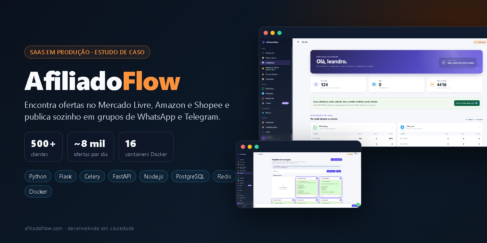
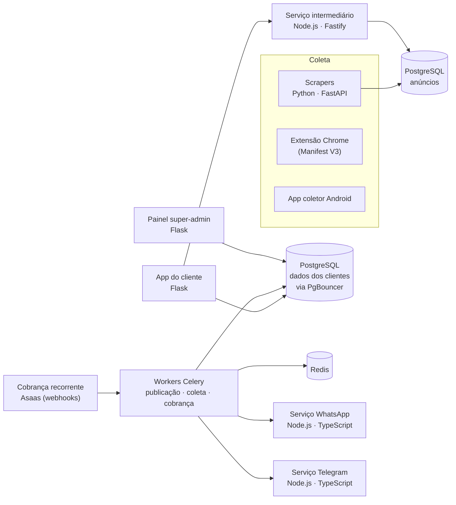
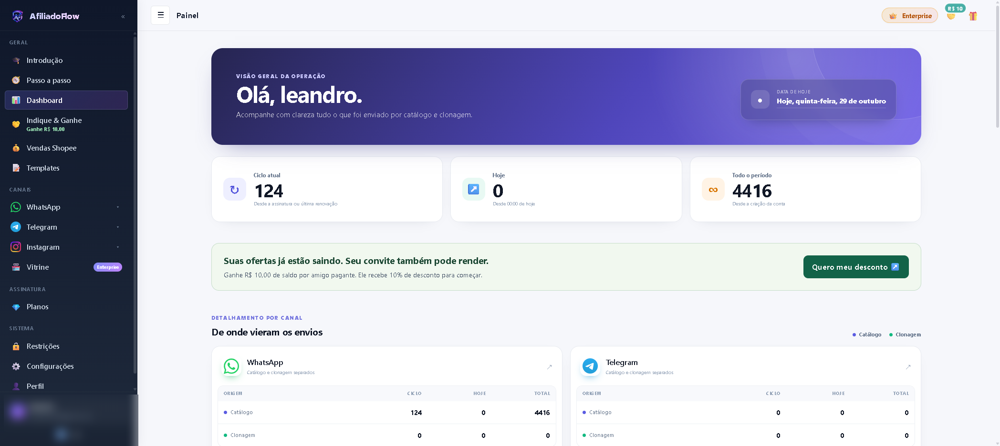
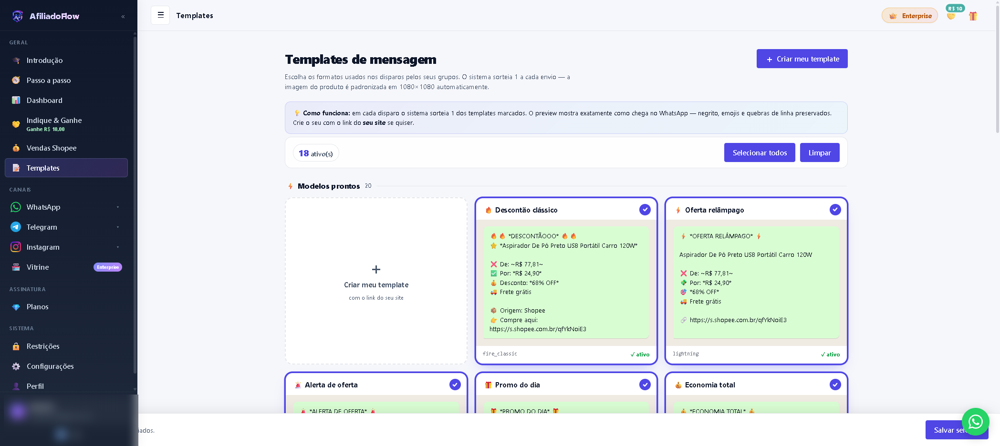
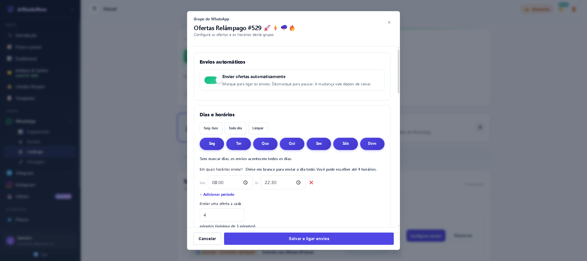

# AfiliadoFlow — SaaS de automação para afiliados

> **Estudo de caso de um produto em produção**, que desenvolvo e mantenho em sociedade. O código é privado; aqui estão o problema, a arquitetura, as decisões técnicas e as telas.
> Site: **[afiliadoflow.com](https://www.afiliadoflow.com)**

        

## O problema

Afiliados do Mercado Livre, da Amazon e da Shopee passam horas garimpando ofertas, gerando o próprio link de afiliado e postando à mão em grupos de WhatsApp e canais do Telegram. É trabalho repetitivo, que trava o crescimento e depende de a pessoa estar online.

## A solução

O AfiliadoFlow faz isso sozinho. O cliente escolhe destinos (grupos e canais), categorias, faixa de preço, desconto mínimo e horários; o sistema encontra as ofertas, gera e valida o link de afiliado do cliente e publica com o modelo de mensagem dele, em intervalos configurados.

| **500+** | **~8 mil** | **16** | **1.000+** |
| :---: | :---: | :---: | :---: |
| clientes | ofertas publicadas por dia | containers Docker | migrações de banco |

## Arquitetura

## Decisões técnicas

- **Pool de produtos pré-filtrados por destino.** Em vez de buscar ofertas na hora de publicar, um worker mantém de 10 a 30 produtos elegíveis por destino e reabastece em segundo plano. A publicação fica rápida e não aparece "sem produto".
- **Sem duplicidade entre workers.** O consumo do pool usa `SELECT … FOR UPDATE SKIP LOCKED`, então workers concorrentes nunca pegam o mesmo produto.
- **Equilíbrio entre marketplaces.** Um agendamento por pesos (*stride scheduling*) alterna Mercado Livre, Amazon e Shopee na proporção configurada pelo cliente.
- **Link validado antes de entrar no pool.** Produtos que não geram link de afiliado ficam marcados no Redis por 24 h e não voltam a ser testados.
- **Filtros que se ajustam sozinhos.** Se um destino fica sem produto, o sistema relaxa os filtros de forma progressiva (palavras-chave, preço, desconto, categorias).
- **Filas separadas por responsabilidade.** Workers Celery dedicados a publicação, coleta e cobrança, com agendamento pelo Celery Beat.
- **Multi-tenant** com isolamento de dados por cliente, PgBouncer na frente do PostgreSQL e backup automatizado do banco.
- **Cobrança recorrente** integrada ao Asaas por webhooks, com régua de inadimplência.

## Telas

<table>
  <tr>
    <td width="50%"> Site</td>
    <td width="50%"> Planos</td>
  </tr>
  <tr>
    <td> Painel do cliente</td>
    <td> Modelos de mensagem</td>
  </tr>
  <tr>
    <td> Dias, horários e intervalos de envio</td>
    <td> Canal do WhatsApp no automático</td>
  </tr>
</table>

Dados pessoais e de grupos aparecem desfocados nas capturas.

## Stack

| Camada | Tecnologias |
| --- | --- |
| Aplicação e workers | Python, Flask, Celery, Celery Beat |
| Coleta | Python, FastAPI, extensão Chrome (MV3), app Android |
| Serviços de mensagem | Node.js, TypeScript (WhatsApp e Telegram), Node.js + Fastify (intermediário) |
| Dados | PostgreSQL, PgBouncer, Redis |
| Infraestrutura | Docker Compose (16 containers), backup automatizado, monitoramento de filas |
| Cobrança | Asaas |

## Meu papel

Produto construído e operado em dupla, do código ao suporte: backend, integrações, banco de dados, infraestrutura e atendimento aos clientes.

---

**Leandro de Jesus Santos** — [LinkedIn](https://www.linkedin.com/in/leandro-js-santos/) · [Portfólio](https://leandrsdev.github.io/portfolio-web/) · [GitHub](https://github.com/LeandrSDEV)
